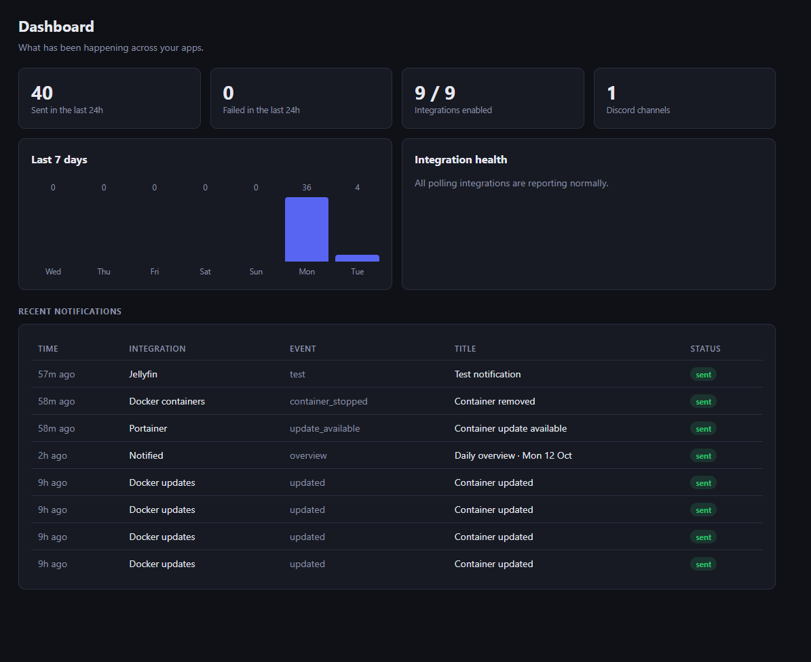
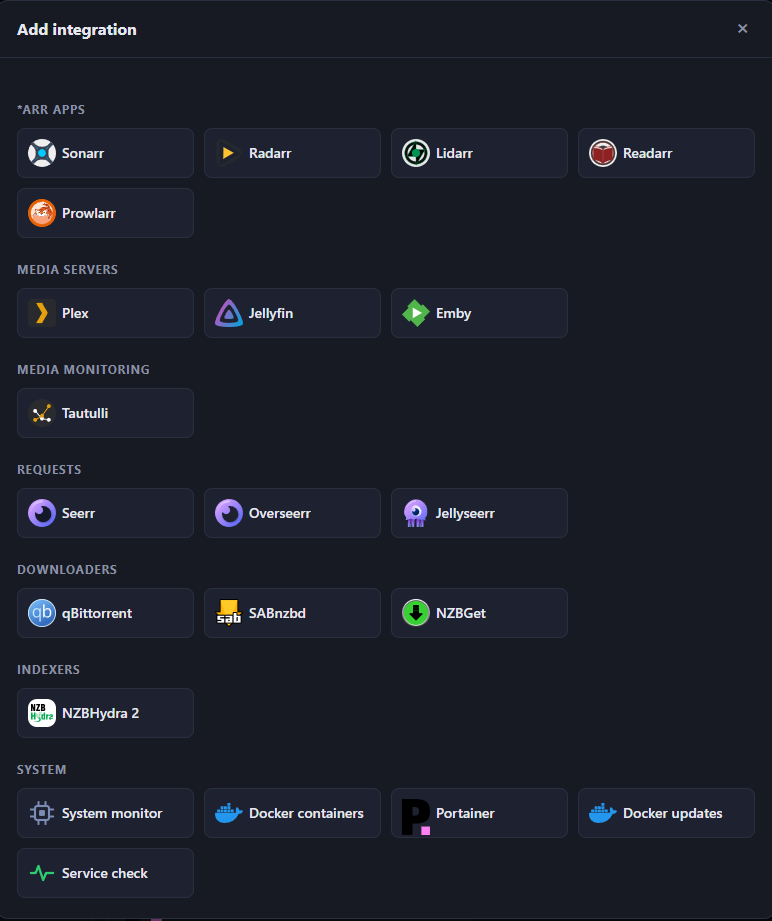

<p align="center"></p>

# Notified

A self-hosted notification hub for a media server stack, inspired by Notifiarr. Your apps send
webhooks to Notified, Notified watches the things that can't send webhooks, and everything is
delivered to Discord as rich embeds. One small container, one SQLite file.





## Integrations

| Group | Apps | Notifies about |
|---|---|---|
| \*arr Apps | Sonarr, Radarr, Lidarr, Readarr, Prowlarr | Grabs, imports, upgrades, health, updates, stuck queue items |
| Media servers | Plex, Jellyfin, Emby | Playback, new items, sign-ins, server events |
| Media monitoring | Tautulli | Playback, recently added, server up/down |
| Requests | Seerr, Overseerr, Jellyseerr | Requests and issues |
| Downloaders | qBittorrent, SABnzbd, NZBGet | Stalled or failed downloads, pauses |
| Indexers | NZBHydra 2 | Indexers disabled and re-enabled |
| System | System monitor, Docker containers, Service check | CPU, memory and disk, container state, services down |
| Container updates | Portainer, Docker updates | New image builds, with one-click updates |

Each event can be switched off or sent to its own Discord channel. A daily overview summarises the
last 24 hours, and the History page shows everything that was received and sent.

## Run it

Copy [docker-compose.yml](docker-compose.yml) to your Docker host and run:

```bash
docker compose up -d
```

Open `http://<host>:8080`, create the admin account, then:

1. **Channels**: add a Discord webhook URL (Discord: channel settings → Integrations → Webhooks).
2. **Integrations**: add your apps. Each one shows its webhook URL and how to set it up.
3. **Settings**: set **Base URL** to the address your apps use to reach Notified.

To update: `docker compose pull && docker compose up -d`, or "pull and redeploy" in Portainer.

## Your data

- Everything lives in the `notified_data` volume. Keep it a named volume (or a full host path):
  a relative path such as `./data` in a Portainer stack or on Docker Desktop can be wiped on restart.
- **Settings → Backup** downloads everything as one file and **Restore** puts it back.
- API keys, passwords and Discord webhook URLs are stored encrypted and never sent back to the
  browser; forms show that a value is saved and let you replace or clear it. The key is created
  automatically in the data folder. To keep it separate from the data, set `NOTIFIED_SECRET_KEY`
  instead, and keep a copy: losing it means re-entering those values.
- Backups contain those secrets in readable form so they restore anywhere. Store them safely.

## Container updates

Notified compares running containers with their registry and lists newer builds of the same tag
under **Container updates**, where one click pulls the image and recreates the container.

- **Portainer**: add the integration with your Portainer URL and an admin access token.
- **Without Portainer** (for example OpenMediaVault): run a socket proxy on that host and add a
  **Docker updates** integration pointing at `http://that-host:2375`:

  ```yaml
  services:
    dockerproxy:
      image: tecnativa/docker-socket-proxy:latest
      restart: unless-stopped
      environment: [CONTAINERS=1, IMAGES=1, NETWORKS=1, DISTRIBUTION=1, POST=1]
      ports: ["2375:2375"]
      volumes: ["/var/run/docker.sock:/var/run/docker.sock"]
  ```

  The proxy has no login, so keep port 2375 on your LAN and firewall it to Notified if you can.

Notified never updates itself, the socket proxy, or containers Portainer shows as *Limited*.

## Settings by environment variable

| Variable | Default | Purpose |
|---|---|---|
| `TZ` | UTC | Timezone for the dashboard and the daily overview |
| `NOTIFIED_SECRET_KEY` | unset | Your own key for encrypting stored secrets |
| `NOTIFIED_PORT` | `8080` | Listen port |
| `NOTIFIED_DATA_DIR` | `/data` | Where the database lives |
| `NOTIFIED_RESET_ADMIN` | unset | Set to `1` for one start to clear the admin login |

## Security notes

- Create the admin account before anyone else can reach the port, and use a reverse proxy with
  HTTPS if Notified is reachable from outside your network.
- Anyone with an integration's webhook URL can post to it; regenerate the URL if it leaks.
- Anyone who can sign in can recreate containers through Portainer or the socket proxy.
- Besides your apps and Discord, Notified contacts GitHub (update check) and jsDelivr (icons).

## Not included (yet)

Discord bot (slash commands, reactions), TRaSH guide sync, media requests from Discord, and multi-user accounts.

## License

MIT, see [LICENSE](LICENSE). The app icons in `web/icons` come from
[dashboard-icons](https://github.com/homarr-labs/dashboard-icons) under the Apache License 2.0.
